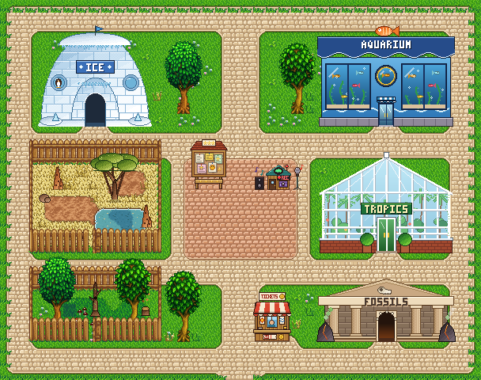

# Stardew Zoo

A Stardew Valley mod that lets you run a walk-in zoo on your farm. Robin builds the zoo,
Marnie sells exotic animals, and every day visitors buy tickets, tour the habitats, chat
with you, and leave reviews that decide how many people come tomorrow.



The mod has two parts that must be installed together:

| Folder | Kind | What it does |
|---|---|---|
| `[CP] Stardew Zoo` | Content Patcher pack | Zoo buildings, animals, the interior map and tilesheet, furniture, translations |
| `StardewZoo` | SMAPI C# mod | Tickets, visitors, reviews, habitats, pavilion doors, animal movement and sounds, recording studio, plaques |

## Features

### Zoo buildings

Robin sells three zoo tiers, which upgrade like a barn. Each has a 7×4 footprint, a
walk-in interior, and a snowy-roof variant in winter. Animals stay inside; there is no
animal door. Construction finishes instantly.

| Building | Cost | Upgrades from | Capacity | Visitor / income multiplier |
|---|---|---|---|---|
| Zoo | 5,000g, 200 Wood, 100 Stone | — | 8 animals | ×1.0 |
| Big Zoo | 10,000g, 250 Wood, 125 Stone | Zoo | 16 animals | ×1.5 |
| Deluxe Zoo | 17,500g, 325 Wood, 175 Stone | Big Zoo | 24 animals | ×2.0 |

Zoos built from an earlier version that still use the vanilla barn interior are moved onto
the zoo map automatically, and leftover barn hay is cleared away.

### Animals and habitats

17 species are sold at Marnie's and can only live in a zoo. They don't produce items or
breed. Each one stays in its biome pen, and the mod moves strays back.

The interior is an open-air park with two fenced pens, plus four walk-in pavilions you enter
through their doors:

| Habitat | Where | Animals |
|---|---|---|
| Ice | Ice pavilion (igloo) | Penguin |
| Water | Aquarium pavilion | Sea Lion, Capybara, Flamingo, Night Heron |
| Savanna | Open-air pen | Lion, Giraffe, Elephant, Alpaca |
| Jungle | Tropics pavilion (greenhouse) | Monkey, Gorilla, Panda |
| Forest | Open-air pen | Bear, Raccoon, Owl, Deer |
| Prehistoric | Fossils pavilion | Dinosaur |

Animals move in their own ways: birds fly and perch in trees, monkeys climb, sea lions swim,
and large animals plod along. Animals that can't swim are kept out of the water. Every species has its own
call, which plays when you pet it or walk close by. The dinosaur's stomps shake the screen
a little when you're nearby.

### Visitors, tickets and reviews

- **Ticket booth** (by the entrance): set the admission price from 0 to 1,000g. The menu
  suggests a fair price and forecasts how many visitors and how much income to expect.
- **Visitor demand** depends on how many species you have (variety matters more than
  headcount), the total number of animals, how many habitats are filled, the zoo tier, your
  ticket price compared with the fair price, recent reviews, and furniture in the zoo.
  A free day draws the biggest crowd but earns nothing.
- **Visitors** walk the zoo during the day, go into the pavilions, and react to animals.
  You can talk to them. What they say depends on the price, their favourite animal, empty
  pens, the weather, the time of day, and their personality. They leave at night and are
  never saved.
- **Income**: each morning you get visitors × ticket price, with a HUD message showing
  yesterday's visitors, income and average rating.
- **Review board** (plaza): recent 1–5 star reviews. High prices for a small collection
  bring bad reviews, and bad reviews mean fewer visitors.

### Recording studio

The studio in the plaza lets you record your own 2.5-second sound for any animal, preview it,
or reset it to the default. Recording uses `ffmpeg` or `sox` if one is installed (the
Homebrew paths are searched on macOS) and falls back to the game's microphone. You can also
drop a 16-bit PCM WAV named after the animal (for example `Lion.wav`) into the mod's
`sounds` folder, and it loads automatically. Default synthesized sounds come with the mod.

> On macOS, the app that runs SMAPI (usually Terminal) needs microphone permission under
> System Settings → Privacy & Security → Microphone.

### Furniture and plaques

Robin sells 30 zoo furniture items: benches, planters, lamp posts, snack and ice-cream carts,
a fountain, a zoo arch, a turnstile, signposts, habitat plaques, a notice board and more. You
can place furniture in the zoo, but not inside animal pens, at booths or doorways, or on the
visitor path (only rugs can go on the path). Each piece adds 1% to visitor demand, up to +10%.

The habitat plaques, signposts, zoo sign, blank plaque and notice board can be read and
edited by right-clicking them. Visitors sometimes comment on what they say.

### Console command

`zoo_status` prints every zoo's animals, species, filled habitats, fair price, projected
visitors and income, along with the current ticket price, rating and a suggested price.

### Languages

English and Simplified Chinese (`zh`).

## Requirements

- Stardew Valley **1.6** (developed against 1.6.15)
- [SMAPI](https://smapi.io/) **4.0.0** or later
- [Content Patcher](https://www.nexusmods.com/stardewvalley/mods/1915) **2.9.0** or later

## Installation

1. Install SMAPI and Content Patcher.
2. Build the C# mod (see below). The output is a `StardewZoo` folder.
3. Copy **both** `[CP] Stardew Zoo` and the built `StardewZoo` folder into your game's
   `Mods` folder.
4. Launch the game through SMAPI.

### Building the C# mod

You need the [.NET 6 SDK](https://dotnet.microsoft.com/download/dotnet/6.0). The project uses
[Pathoschild.Stardew.ModBuildConfig](https://www.nuget.org/packages/Pathoschild.Stardew.ModBuildConfig),
which references the game DLLs and, after a successful build, copies the mod into
`<GamePath>/Mods/StardewZoo` and creates a release zip in the build output folder under `StardewZoo/bin/`.

```sh
dotnet build StardewZoo/StardewZoo.csproj -c Release
```

`StardewZoo.csproj` sets `GamePath` to the default Steam install on macOS
(`~/Library/Application Support/Steam/steamapps/common/Stardew Valley/Contents/MacOS`).
For any other install, set it on the command line:

```sh
dotnet build StardewZoo/StardewZoo.csproj -c Release -p:GamePath="/path/to/Stardew Valley"
```

To build without copying into `Mods`, add `-p:EnableModDeploy=false`.

The content pack doesn't need building. Copy `[CP] Stardew Zoo` into `Mods` as it is.

On macOS with the default Steam path, `./deploy.sh` runs the tests, builds the mod, and syncs
the content pack into `Mods` in one step.

### Configuration

After the first launch, the mod creates `Mods/StardewZoo/config.json`. You can change the
ticket price range, the demand and pricing parameters, per-tier multipliers, how many visitors
appear on screen, the furniture bonus, and toggles for animal calls when you walk near them,
species movement and the dinosaur's screen shake.

## Development

### Tests

```sh
dotnet test StardewZoo.Tests
```

The tests cover the pure logic: income and demand, habitats and layout, visitor chat and
spawning, proximity calls, animal behaviour, water rules, furniture placement, decor bonus,
plaques and WAV/recording handling.

### Regenerating assets

Almost everything in `[CP] Stardew Zoo` is generated by the Python scripts in `tools/`:
sprites, the tilesheet, the map, `content.json` and the default sounds. `StardewZoo/ZooLayout.g.cs`
is generated too. **Don't edit generated files by hand.** Change the generator and run it
again.

Requirements: Python 3 and [Pillow](https://python-pillow.org/) (`pip install Pillow`).

Several scripts (`draw_tiles.py`, `make_sprites.py`, `render_map.py`, `validate_map.py`)
read vanilla textures and maps from **unpacked game content**. Unpack the game's `Content`
folder with [StardewXnbHack](https://github.com/Pathoschild/StardewXnbHack). `tools/vanilla.py`
expects the result in `Content (unpacked)` inside the macOS Steam game folder:

```
~/Library/Application Support/Steam/steamapps/common/Stardew Valley/Contents/MacOS/Content (unpacked)
```

If your game is somewhere else, edit `GAME` in `tools/vanilla.py`.

Common commands:

```sh
cd tools
python3 make_map.py        # zoo tilesheet + interior TMX (+ ZooLayout.g.cs and a preview)
python3 validate_map.py    # sanity checks for the map; fails if ZooLayout.g.cs is stale
python3 make_sprites.py    # zoo building exteriors (incl. winter variants)
python3 draw_animals.py    # animal sprite sheets, babies and shop icons
python3 draw_furniture.py  # furniture sheet
python3 make_sounds.py     # default animal WAVs
python3 write_content.py   # [CP] Stardew Zoo/content.json
python3 render_map.py      # render the TMX to a PNG preview
```

`tools/zoo_layout.py` is the single source of truth for the interior layout (pens, pavilions,
booths, paths and the visitor route), shared by the map generator and the C# mod. Debug
previews go to `tools/previews/`, which git ignores.

### Project layout

```
[CP] Stardew Zoo/      Content Patcher pack (manifest, content.json, assets/, i18n/)
StardewZoo/            SMAPI C# mod (manifest, source, i18n/, sounds/defaults/)
StardewZoo.Tests/      xUnit tests for the mod's pure logic
tools/                 Python generators for map, tiles, sprites, sounds and content.json
docs/                  Design spec, implementation plan, README images
deploy.sh              macOS build-and-install helper
```

## Mod IDs

| Package | UniqueID | Version |
|---|---|---|
| `[CP] Stardew Zoo` | `Kenzie.StardewZoo.CP` | 1.0.0 |
| `StardewZoo` | `Kenzie.StardewZoo` | 1.0.0 |

## License

Released under the [MIT License](LICENSE).
